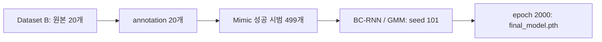
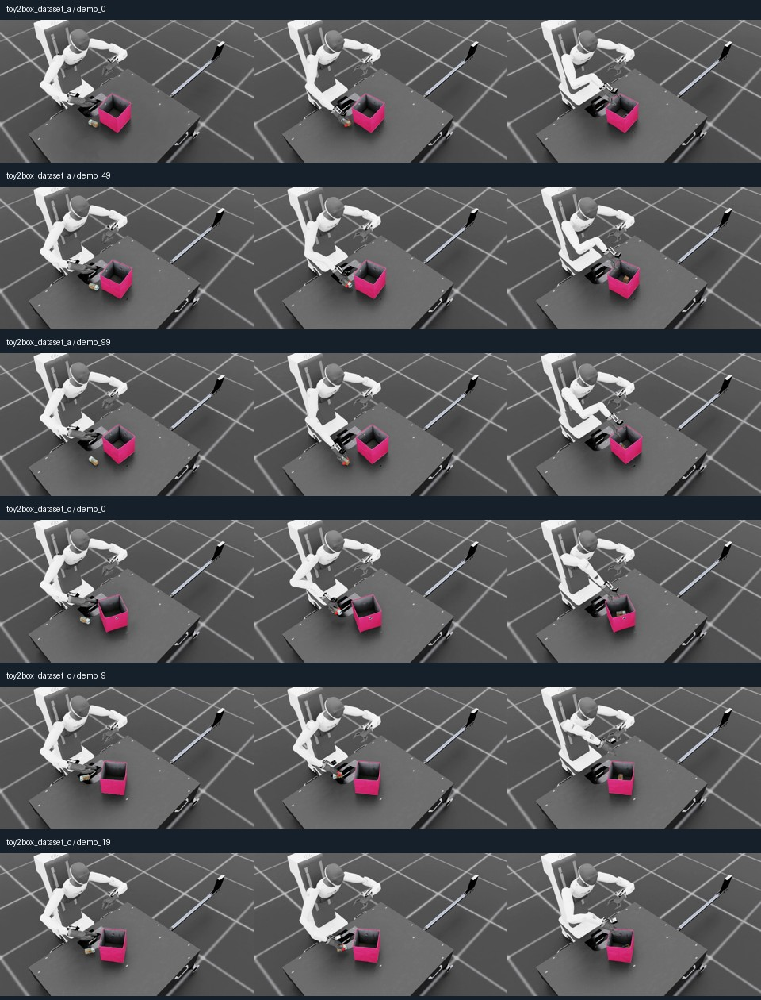

# Agibot Toy2Box — Robotics Simulation Assignment 2

**연구 질문:** 사람 시범으로 학습한 BC 정책은 Toy2Box에서 왜 성공률이 저조한가? 원인 하나를 진단하고 그 원인을 겨냥해 성공률을 높인다.


## 제출 파일

| 제출 항목 | 위치 | 상태 |
|---|---|---|
| 최종 모델 1개 | [models/final_model.pth](models/final_model.pth) | Dataset B → Mimic 499개 → epoch 2000, 학습 seed 101 |
| 평가 명령어 | [submission/evaluate.txt](submission/evaluate.txt) | 검증 seed 42, rollout 100회, horizon 800 |
| 5분 발표 PPT | [submission/toy2box_presentation_draft.pptx](submission/toy2box_presentation_draft.pptx) | 7장 초안, 정식 평가·통제 실험 보완 필요 |
| 제출 기준과 확인 항목 | [submission/requirements.md](submission/requirements.md) | PDF 47~54페이지 대응 |


## 데이터 세트

| 실험 이름 | 구성 | 시범 수 | 평균 길이 | idle 평균 | 용도 |
|---|---|---:|---:|---:|---|
| **Dataset A** | 기준 동작 구성 | 100 | 14.61초 | 0.70% | 수집·증강 참고 기준 |
| **Dataset B** | 속도 변화·짧은 멈춤 구성 | 20 | 17.68초 | 4.78% | 최종 모델의 원본 계열 |
| **Dataset C** | idle 목표 21%·분산 멈춤 구성 | 20 | 21.02초 | 19.79% | 동작 시간 구성 비교용 |

A/B/C는 데이터 세트 식별자이며 시범 개수나 소요 시간을 뜻하지 않는다. 수집 방식과 실행 이력은 [수집 기록](docs/data_collection.md)에 정리했다. idle은 팔의 이동·회전 명령 6개가 모두 정확히 0인 프레임의 비율이며, 그리퍼 값은 제외한다. 수집 통계는 BC 정책 평가 성공률과 구분한다.

- 공개 데이터: [Dataset A / Dataset C HDF5](https://github.com/Kim-KiSuk/Robotics-Simulation-Assignmnet2/releases/tag/collection-2026-10-28)
- [수집 방법·전체 통계](docs/data_collection.md) · [파일명 대응·SHA256](data/manifest.json)
- [최종 모델의 학습 이력](docs/training_status.md) · [학습 config](configs/final_train_config.json)

## 최종 모델의 데이터 흐름



Dataset C은 이 모델의 학습 원본이 아니다. 두 20개 데이터 계열은 별도 실험 이름으로 관리한다. [데이터 내용 해시로 확인한 연결 관계](reports/dataset_lineage.json)를 제공한다.

## 영상

[](docs/videos.md)

| 데이터 | 실제 시범 재생 영상 |
|---|---|
| Dataset A | [demo_0](videos/dataset_a/demo_0.mp4) · [demo_49](videos/dataset_a/demo_49.mp4) · [demo_99](videos/dataset_a/demo_99.mp4) |
| Dataset C | [demo_0](videos/dataset_c/demo_0.mp4) · [demo_9](videos/dataset_c/demo_9.mp4) · [demo_19](videos/dataset_c/demo_19.mp4) |

위 6개는 HDF5 초기 상태와 저장 action을 실제 시뮬레이터에서 재생한 영상이다. 선택한 6개 모두 기존 성공 조건을 10 step 연속 충족했다. 학습된 정책의 독립 평가 영상과는 구분한다. [영상 설명·검사 결과](docs/videos.md)를 참고한다.

## 실행

기존 IsaacLab_RS 환경에서 다음 명령을 실행한다. `REPO`는 이 저장소의 절대 경로다.

```bash
conda activate lerobot-arena
cd /home/kisuk/IsaacLab_RS
REPO=/home/kisuk/IsaacLab_RS/Robotics-Simulation-Assignmnet2

./isaaclab.sh -p "$REPO/isaaclab_project/scripts/imitation_learning/robomimic/play.py"   --task Isaac-Place-Toy2Box-Agibot-Right-Arm-RmpFlow-v0   --checkpoint "$REPO/models/final_model.pth"   --num_rollouts 100 --horizon 800 --seed 42 --headless
```

새 환경에는 [설치·재현 방법](docs/reproduction.md)에 따라 고정한 IsaacLab_RS 기반 코드 위에 `isaaclab_project/`를 적용한다. 로봇·물체 USD와 Isaac Sim 자체는 별도 설치 자산이다.

## 평가 상태

선택 모델의 로드·추론 실행을 확인했다. [부분 실행 기록](submission/model_smoke_check.json)은 100회 정식 평가 결과가 아니다. 학습 seed 101·111의 공정 비교, 실패 단계 정량 분류와 단일 요인 통제 실험은 별도 보완 항목이다. 발표 PPT에서도 미완료 항목을 결과와 구분했다.

## 폴더

```text
isaaclab_project/       과업 환경·로봇·RMPFlow·BC 학습 및 평가 코드
models/                최종 가중치 1개와 SHA256 manifest
submission/            평가 명령어, 제출 기준, 발표 PPT 초안
configs/               선택 모델과 참고 학습 설정
reports/               episode CSV, 수집 로그, 데이터 연결·영상 검사
videos/                Dataset A·Dataset C 재생 영상, 정책 참고 영상
tools/                 다운로드·분석·재생·설치 도구
```

검증: `python -m pytest -q tools/collection/test tools/test`.
[외부 코드 고지](THIRD_PARTY_NOTICES.md)를 참고한다.
