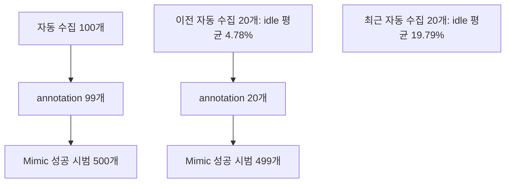

# Robotics Simulation Assignment 2 — Agibot Toy2Box

Agibot 오른팔로 트럭 장난감을 박스에 넣는 Toy2Box 과업의 데이터 수집, Mimic 증강 이력, 재생 영상과 연구계획을 정리한 저장소입니다.

- 과업: `Isaac-Place-Toy2Box-Agibot-Right-Arm-RmpFlow-v0`
- 제어: RMPFlow, 상대 위치·회전 6차원 + 그리퍼 1차원
- 데이터 제어 주기: 20 Hz
- 정리 기준일: 2026-10-28 (Asia/Seoul)

## 바로 보기

| 내용 | 문서·파일 |
|---|---|
| 네 연구 축의 새 주제 12개와 실험 개요 | [Markdown](docs/research_topics.md) · [일반 텍스트](docs/research_topics.txt) |
| 데이터 수집 방법·통계·버전 관계 | [수집 기록](docs/data_collection.md) |
| 실제 시범 재생 영상·정책 참고 영상 | [영상 목록](docs/videos.md) |
| 다운로드·수집·재생·분석 명령 | [재현 방법](docs/reproduction.md) |
| BC 학습 설정과 확인 범위 | [학습 기록](docs/training_status.md) |
| 주요 HDF5 원본 2개 | [데이터 Release](https://github.com/Kim-KiSuk/Robotics-Simulation-Assignmnet2/releases/tag/collection-2026-10-28) |
| 원본 파일 무결성 | [파일 크기·SHA256](data/manifest.json) |

## 주요 수집 데이터

| 항목 | 이전 100개 데이터 | 최근 20개 데이터 |
|---|---:|---:|
| 파일 | `toy2box_agibot_auto_100.hdf5` | `toy2box_agibot_idle21_n20.hdf5` |
| 실제 수집 방식 | 자동 피드백 제어 | 속도 변화·멈춤·작은 보정을 넣은 자동 피드백 제어 |
| 저장된 성공 시범 | 100 | 20 |
| 총 시도 | 278 | 120 |
| 수집 시도 성공률 | 35.97% | 16.67% |
| 총 프레임 | 29,229 | 8,406 |
| 평균 시범 길이 | 14.61초 | 21.02초 |
| episode별 idle 평균 | 0.70% | 19.79% |
| episode별 idle 범위 | 0.50~0.85% | 18.48~20.89% |
| 그리퍼 전환 | 모든 시범 2회 | 모든 시범 2회 |
| 수집 seed | 42 | 101 |

`idle`은 팔의 이동·회전 명령 6개가 모두 정확히 0인 프레임의 비율입니다. 그리퍼 값은 idle 계산에서 제외합니다. 저장된 성공 시범만 있는 비율과 전체 수집 시도의 성공률은 구분합니다. 위 수치는 BC 정책 평가 성공률이 아닙니다.

두 데이터는 수집 seed와 동작 방식이 다릅니다. 이 표 자체를 한 요인 통제 실험의 결과로 해석하지 않습니다. 최신 20개도 실행 로그에 `mode: automatic`, `motion_style: varied`가 기록되어 있습니다.

## 실제 시범 재생 영상

두 HDF5의 초기 상태를 복원하고 저장된 action을 순서대로 실행하여 새로 렌더링했습니다. 각 데이터에서 처음·중간·마지막 시범을 골랐습니다. 전체 120개를 검증한 결과는 아닙니다.

[](docs/videos.md)

| 데이터 | 대표 영상 |
|---|---|
| 100개 자동 수집 | [demo_0](videos/toy2box_agibot_auto_100/demo_0.mp4) · [demo_49](videos/toy2box_agibot_auto_100/demo_49.mp4) · [demo_99](videos/toy2box_agibot_auto_100/demo_99.mp4) |
| 최근 20개 자동 수집 | [demo_0](videos/toy2box_agibot_idle21_n20/demo_0.mp4) · [demo_9](videos/toy2box_agibot_idle21_n20/demo_9.mp4) · [demo_19](videos/toy2box_agibot_idle21_n20/demo_19.mp4) |

선택한 6개는 재생 중 기존 task 성공 조건을 10 step 연속 충족했습니다. [재생 판정 기록](videos/replay_results.json)과 [영상 디코딩 검사](reports/video_audit.json)를 함께 제공합니다. 성공 판정·환경·초기 물체 위치를 영상용으로 바꾸지 않았습니다. 재생 중 자동 종료만 비활성화하여 저장된 action 전체를 실행했습니다.

## 데이터 버전 관계



파일명 `annotated_100`에는 실제 99개가 있고 원본 `demo_39`가 포함되어 있지 않습니다. 기존 20개 annotation의 action·손끝 위치는 이전 `auto_n20`과 모두 일치하며, 최신 `idle21_n20`과는 일치하지 않습니다. 최신 20개에서 새로 생성한 Mimic 데이터는 이 아카이브에 없습니다. [내용 해시로 확인한 연결 관계](reports/dataset_lineage.json)를 참고하세요.

## 빠른 시작

주요 HDF5 두 개는 Git 이력 대신 Release assets로 제공합니다. 나머지 5개 로컬 파일은 원본을 공개 업로드하지 않았으며 통계·버전 연결 정보만 보관합니다.

```bash
git clone https://github.com/Kim-KiSuk/Robotics-Simulation-Assignmnet2.git
cd Robotics-Simulation-Assignmnet2
python tools/download_data.py
```

다운로드 도구는 파일 크기와 SHA256을 확인합니다. 주요 원본 두 개의 통계 재생성은 다음과 같습니다.

```bash
python tools/analyze_datasets.py --dataset_dir ./data
```

분석에는 `h5py`, `numpy`가 필요합니다. 실제 영상 재생에는 Agibot task와 자산이 설치된 IsaacLab_RS/Isaac Sim 및 NVIDIA GPU가 필요합니다. [전체 명령](docs/reproduction.md)을 확인하세요.

## 파일 구성

```text
docs/                  연구주제·수집 기록·영상 안내·재현 명령
reports/               episode별 CSV, 요약 JSON, 원본 수집 실행 로그
data/manifest.json     Release HDF5 목록, 크기, SHA256
configs/               실제 BC 학습 설정 사본
tools/                 분석·다운로드·영상 재생 도구
tools/collection/      수집기 및 동작 변화·수동 가이드 모듈 스냅샷
videos/                대표 시범 재생 MP4, 기존 정책 참고 MP4, 미리보기
```

현재 수집기 스냅샷은 정리 시점의 코드입니다. 이전 100개를 수집할 당시 코드와 완전히 동일하다고 보장하지 않으며, 수집 당시 설정은 각 `.run.json`을 기준으로 확인합니다.

오프라인 검증은 `python -m pytest -q tools/collection/test tools/test`로 실행합니다. [외부 코드 고지](THIRD_PARTY_NOTICES.md)도 참고하세요.
